# Residuos_Solidos
---

#  Gestão de Resíduos Sólidos

 Gerenciamento e monitoramento de resíduos sólidos. O sistema permite o controle de acesso de usuários e os (CRUD) de ocorrências.

---

## MER DER conceitual 

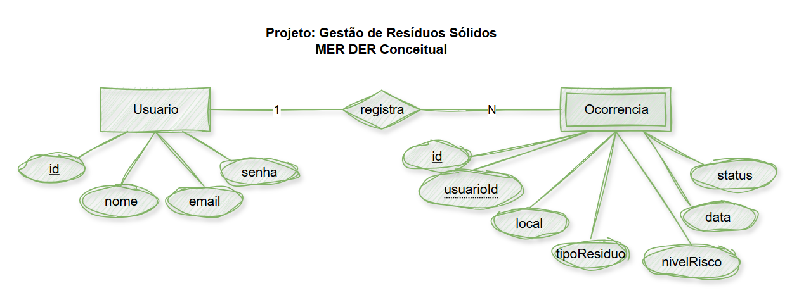

## UML 

---

##  Tecnologias Utilizadas

*   Node.js 
*   MySQL 
*   VSCode
*   JavaScript
*   Insomnia
*   XAMPP

---
## Instruções
 ---
 1 - Use os códigos no repositório acima, inicie o servidor no terminal (CMD) com as dependências:

 - npm init -y
 - npm i express cors
 - npm install mysql2
 - npm run dev

2 - Inicie uma nova página no Insomnia, usando o link do servidor, e teste os códigos.

---
## CRUDS

# Listar Usuarios
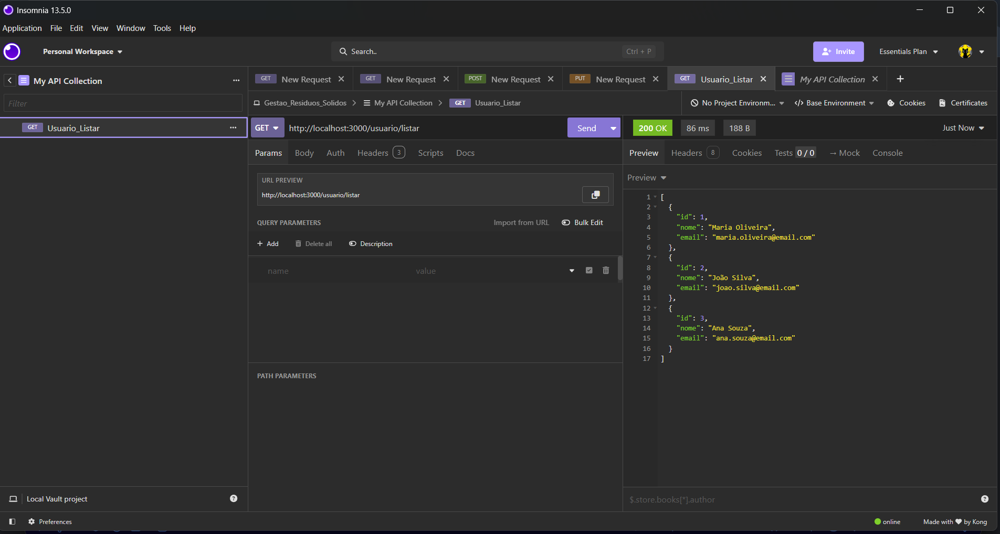

# Cadastrar Usuarios
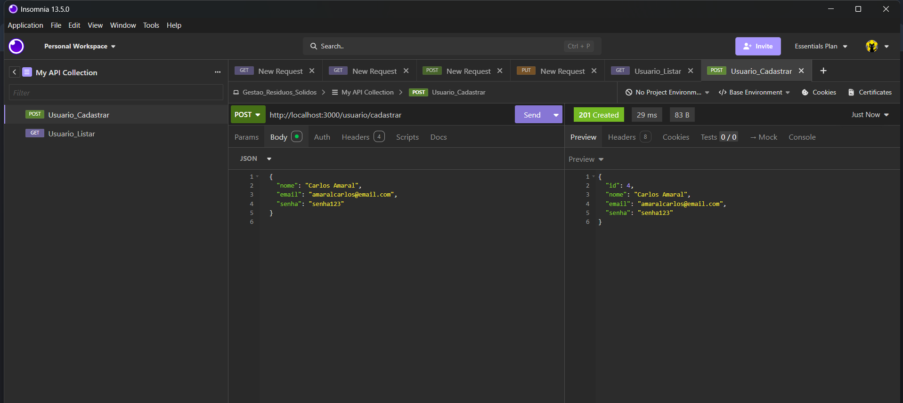

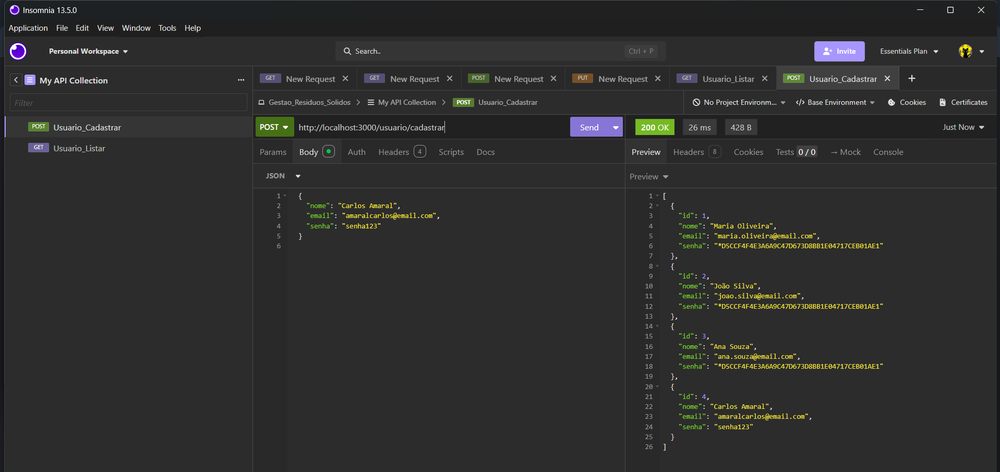

# Alterar Usuarios
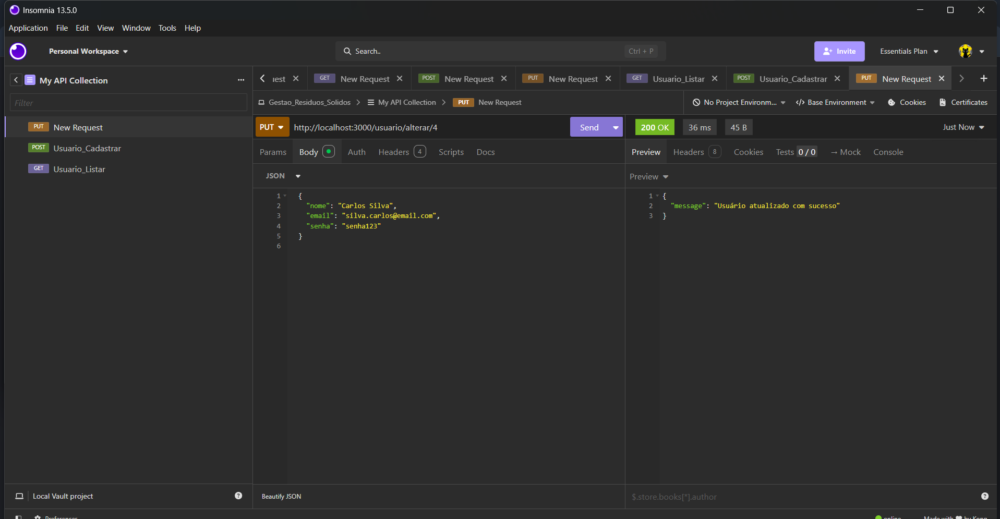

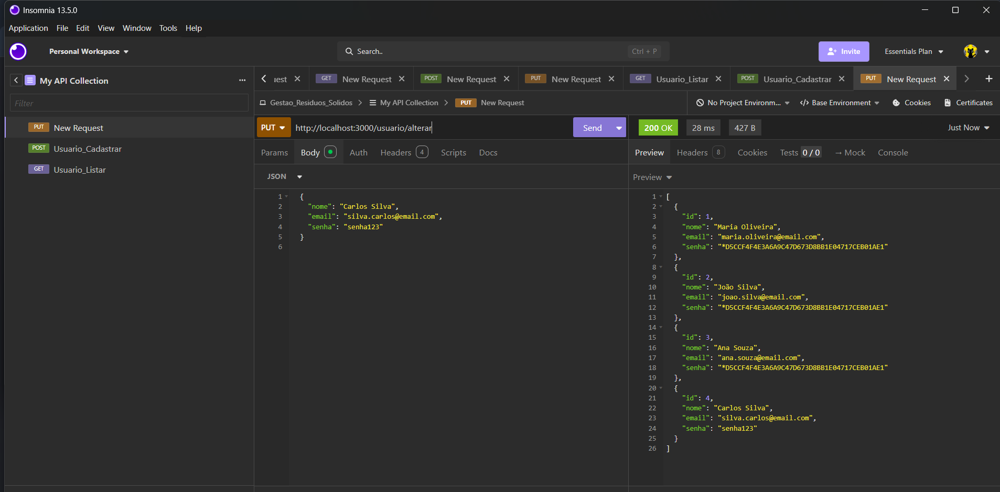

# Excluir Usuarios
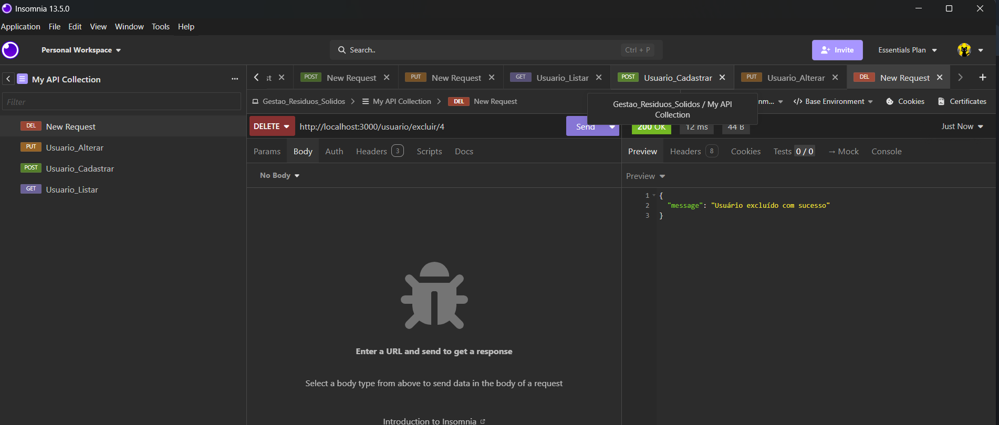

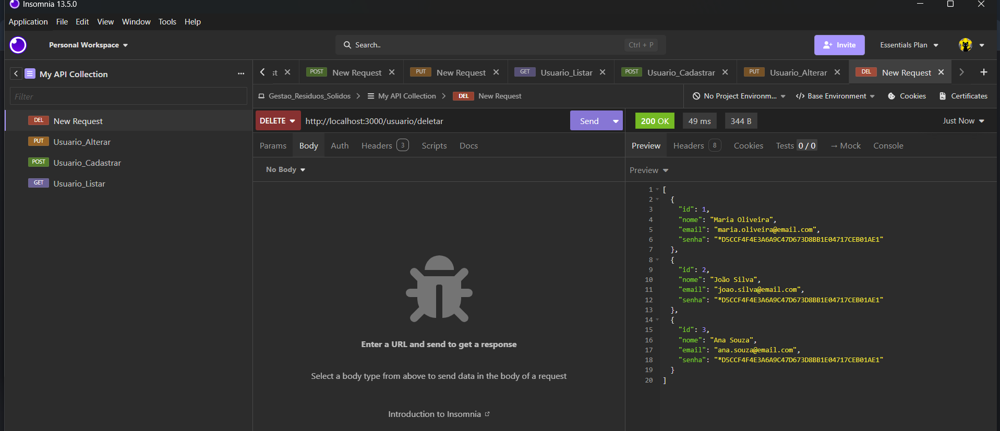

# Login Usuarios 
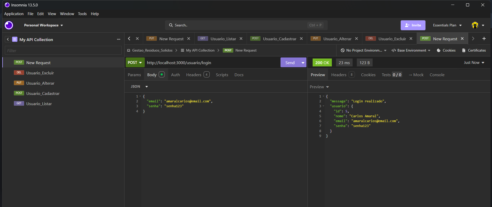

 # Listar Ocorrencias
 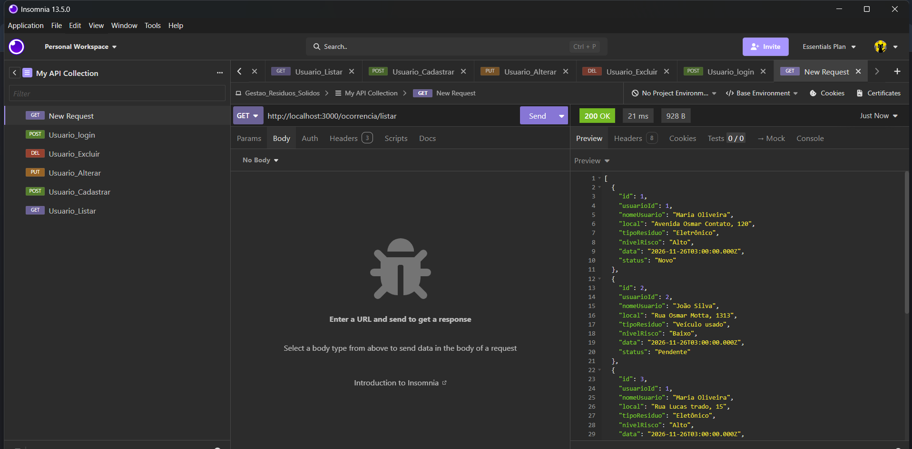

 # Cadastrar Ocorrencias
  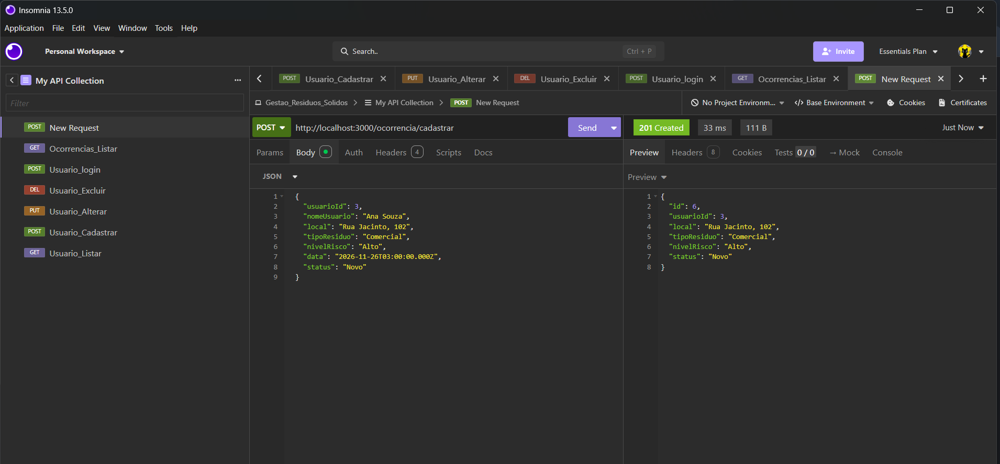

   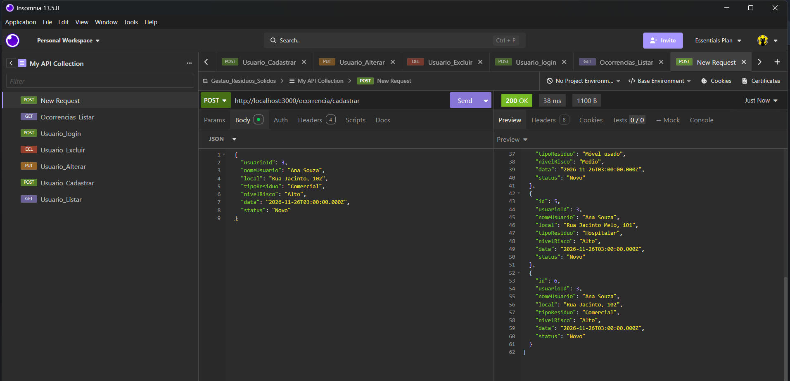

   # Alterar Ocorrencias 
 

  

  # Excluir Ocorrencias 
   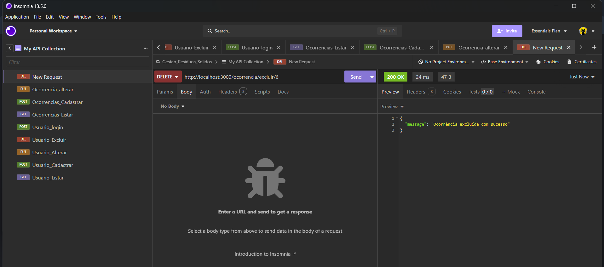

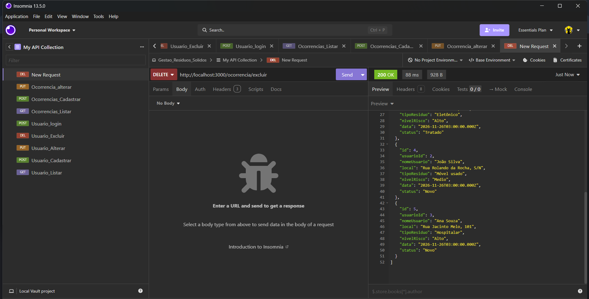
